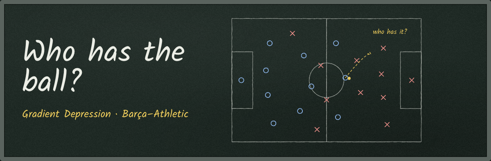

# Who has the ball?

[](https://aleetreny.github.io/bcn-gradient-depression/)

**23rd of 759 ranked entries · 0.647917 spell-F1**

Gradient Depression · More Than A Hack 2027 · Initial Challenge

Source: organisers’ final scoreboard, 20 November 2026.

A defender gets a toe to a pass. Does that touch start a new possession? For FC Barcelona vs Athletic Club, we had to answer that kind of question 25 times a second, including the stretches when the ball disappeared from tracking. The organisers scored complete possessions across the full match. Splitting a long pass into several apparent turnovers could cost more than getting a few individual frames wrong.

**[Open the interactive tactics board →](https://aleetreny.github.io/bcn-gradient-depression/)**

[How v11 works](https://aleetreny.github.io/bcn-gradient-depression/#13) · [Official result](https://aleetreny.github.io/bcn-gradient-depression/#20) · [Technical report](ENTREGA_FINAL_HACKATHON/gradient_depression.md)

## From moving dots to spells of possession

1. **Read the play.** We trained on public Sportec matches and simulated tracking dropouts. Trees read distances and ball physics, sequence models followed movement, and a player-set network read the shape of the two teams. Swapping team identities during inference helped treat home and away consistently.
2. **Connect the frames.** The models estimate who controls the ball, whether play has stopped, and where control changes. A semi-Markov decoder combines those signals with plausible possession durations. This lets a pass travel past an opponent while possession stays with the passing team.
3. **Revisit the difficult touches.** Several model families look for agreement around short steals, deflections and restarts. A release or contact can move a spell boundary. Smart tags and whistle cues help locate stoppages. The delivered entry was the retrained **v11 `grand`** variant.

The presentation follows the project from a nearest-player baseline through v8.5 and the v9–v11 work. Bernardo Guterres created the original interactive chalkboard with Claude. The diagrams are schematic. [Presentation source](presentation/) · [Official scoring method](EVALUATION.md)

## How we tested it

Sportec leave-one-match-out folds tested transfer to a different match. Three Metrica sample games gave us a second tracking source. One calibration step used those Metrica games. The five labelled Barça–Athletic minutes served as a reporting window under the project protocol. Their score was visible during historical dead-ball development. The organisers’ full-match scoreboard supplies the competition result above. [Validation and selection history](ENTREGA_FINAL_HACKATHON/gradient_depression.md#4-validation)

Before the final kickoff correction, the retrained candidate scored lower than historical v11 in the paired external checks. We used the retrained variant because we could replay its delivery from retained inputs. [Registered comparison](experiments/runs/external_retrained_v11/result.json)

## Run the public checks

Use Python 3.11 from the repository root.

```sh
python3.11 -m venv .venv
source .venv/bin/activate
python -m pip install -r requirements-lock.txt
python scripts/check_official.py
```

The scorer check uses the organisers’ public example files. To explore the modelling code, start with the [model implementations](src/), [registered components](harness/components.py) and [experiment protocol](docs/HARNESS.md).

## Reproducing the delivery

The registered chain regenerated the delivered file byte for byte in a fresh checkout with a hash-checked set of local inputs. Exact replay requires retained weights and intermediate predictions, including early sequence-model outputs. The reconstruction record lists what was rebuilt, what was retained and the commands used. Competition match assets and the team’s prediction CSV stay outside the public release.

| Delivery record | Value |
| --- | --- |
| Variant | Retrained v11 `grand` |
| Output | One home, away or dead-ball label per frame |
| SHA-256 | `cc5bf45fc040eead80a3d66e7e974192b3a600f29d80f58d5bbb489bafbca2a3` |

[Reconstruction record](docs/v11_clean_clone_status.md) · [Chain runner](scripts/v11_big_leap/run_v11_chain.py) · [Challenge and data terms](https://github.com/metrica-sports/more-than-a-hack-2027) · [Source provenance](SOURCE_PROVENANCE.md)
